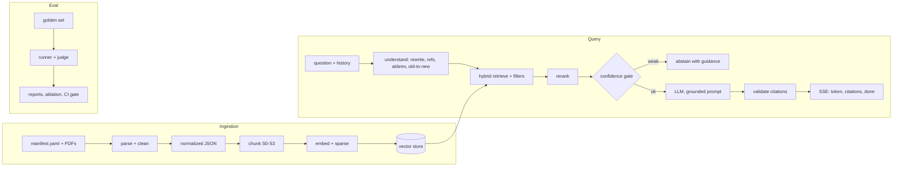

# Legal Assist RAG

Legal Assist is a locally runnable retrieval-augmented generation (RAG) application for questions about
Indian legal and banking documents. You supply the PDFs, and the application turns them into a searchable
corpus, retrieves relevant passages, and generates answers with citations.

The project includes:

- A FastAPI backend with streaming answers and document uploads
- A Next.js web interface and a smaller static UI
- Structure-aware PDF ingestion, hybrid retrieval, and citation validation
- Safeguards for weak evidence, abuse prevention, and isolated temporary uploads
- Fixtures and an evaluation framework for testing retrieval and generation
- Docker, GitHub Actions, and local tooling for running and checking the service

> Informational only; not legal advice.

**Project status:** the application code and test suite are in place, with 219 automated tests currently
passing. Most tests run against synthetic fixtures rather than real legal documents. The repository does
not include a final real-world corpus or verified set of benchmark questions, so no retrieval-quality or
answer-quality claims are established on real data yet. See [What is still needed](#what-is-still-needed).

## Contents

- [How it works](#architecture)
- [Quick start](#quickstart)
- [Bring your own PDF corpus](#bring-your-own-pdf-setup)
- [Running the web interface](#web-ui-nextjs--typescript-web)
- [API overview](#api-all-under-v1-openapi-at-docs)
- [Configuration](#configuration)
- [Project layout](#project-layout)
- [Testing and development](#testing-and-development)
- [Known limitations](#limitations)
- [Documentation](#documentation)

## Architecture



Stages are separate callables; retrieval returns structured results (`SearchResult`), the pipeline is
stateless (history is injected), and the same code path serves the API and the eval runner.

### How a question is answered

1. **The document corpus is prepared.** PDFs are parsed, cleaned, classified, split into sections, and
   converted into searchable chunks.
2. **The question is understood.** References, abbreviations, domain hints, and older-law names may be
   normalized before retrieval.
3. **Relevant passages are found.** The application combines dense semantic search with lexical search,
   filters by document domain or currency, and applies optional reranking.
4. **The answer is checked.** If the evidence is weak, the service may abstain. Otherwise, the model
   receives a grounded prompt and the response is checked for valid citation markers.
5. **The result is streamed.** The client receives answer tokens, structured citations, currency notes,
   and a final completion event through Server-Sent Events.

## Quickstart

### Prerequisites

- Python 3.11
- `uv` (recommended), or Python with `pip`
- Node.js and npm for the Next.js interface
- An LLM API key for real answers

Docker and Docker Compose are available as alternatives for deployment-style runs.

### Bring-your-own-PDF setup

This repository does not include a PDF corpus or a generated index. Each user creates their own local
corpus. This keeps private documents and machine-specific settings out of GitHub.

1. Clone the repository.
2. Copy `.env.example` to `.env` and add your `LLM_API_KEY`.
3. Put text-based PDF files under `data/raw/`, `data/raw/legal/`, or `data/raw/banking/`.
4. Start the backend. The local manifest and vector index are generated automatically when startup
   synchronization is enabled.

`data/SOURCES.json` is a reference list, not a downloadable PDF corpus. Local PDFs, `data/manifest.yaml`,
processed files, caches, logs, and `.env` files are ignored by Git.

```bash
uv sync                                   # or: pip install -e . pytest pytest-asyncio pytest-cov ruff
cp .env.example .env                      # set LLM_API_KEY (Groq) and ADMIN_API_KEY
uv run pytest && uv run ruff check .
make demo                                 # fixture corpus + fake LLM, UI at http://127.0.0.1:8000/ui/
```

The ingestion commands below let you inspect or rebuild your corpus. New PDFs are classified by domain,
document type, title, and year; unchanged files are skipped; changed files are re-indexed. Existing manual
edits in `data/manifest.yaml` are preserved.
See [docs/data_folder_guide.md](docs/data_folder_guide.md).

```bash
python -m legal_rag.ingestion sync                  # incremental: classify, append manifest, index changes
python -m legal_rag.ingestion --dry-run sync        # preview only
python -m legal_rag.ingestion sync --prune          # also drop deleted files from the index + manifest
python -m legal_rag.ingestion sync --force          # rebuild all (after changing embedding model/chunking)
python -m legal_rag.ingestion --yes report          # docs/ingestion_report.md
# or skip the CLI: set AUTO_SYNC_ON_STARTUP=true in .env and just (re)start the API
uvicorn legal_rag.api.main:create_app --factory
curl -N -X POST localhost:8000/v1/ask -H 'content-type: application/json' \
     -d '{"question":"What is the punishment for theft?"}'
```

Windows without `make`: `.\make.ps1 <target>`. Docker: `docker compose up -d --build` (see limitations).
Set `EMBEDDING_MODEL=all-MiniLM-L6-v2` and install `uv sync --extra embeddings` for a real embedder; the
offline `hashing-512` embedder is for tests and CI only.

### Try the demo without a real PDF corpus

The built-in demo uses evaluation fixtures and a fake LLM, so it does not require a Groq account or a local
PDF collection:

```bash
make demo
```

Then open `http://127.0.0.1:8000/ui/`. If `make` is unavailable on Windows, use
`.\make.ps1 demo`.

The demo is useful for checking the API and UI, but it is not a test of real retrieval quality or model
accuracy.

## Web UI (Next.js + TypeScript, `web/`)

The Next.js interface provides a three-panel workspace: conversations and uploads, the question panel,
and answers with supporting passages. It shows streamed responses, citation markers, document status,
currency notes, feedback controls, upload-chat controls, and operational metrics. The interface supports
light and dark themes.

```bash
cd web
cp .env.example .env.local      # set NEXT_PUBLIC_API_URL to your API, e.g. http://127.0.0.1:8010
npm install
npm run dev                      # http://localhost:3010
```

Configure `CORS_ORIGINS=http://localhost:3010` when running the web interface locally. TypeScript and
production-build checks run in CI. The API also serves a smaller static interface at `/ui/`.

The static demo has been checked manually with the fake-LLM demo server. Automated browser tests are not
included yet.

## API (all under `/v1`, OpenAPI at `/docs`)

| Endpoint | Purpose |
|---|---|
| `POST /v1/ask` | SSE stream: `token`, `citations` (structured + sanitized answer + currency notes), `abstained`, `done`, `error`. Optional `domain`, `conversation_id`, `upload_id`. |
| `POST /v1/documents/upload?filename=` | Raw-body upload (.pdf/.txt, size/page/chunk caps) into an ephemeral, isolated, TTL-bound index |
| `DELETE /v1/documents/session/{upload_id}` | Delete an upload now |
| `GET /v1/stats`, `GET /v1/metrics` | Corpus counts; latency p50/p95 per stage, error and abstention rate |
| `POST /v1/feedback` | Thumbs up/down tied to the request ID |
| `GET /v1/admin/traces/{request_id}`, `DELETE /v1/admin/documents/{doc_id}` | Admin (`X-API-Key`; disabled if `ADMIN_API_KEY` unset) |
| `GET /health`, `GET /ready` | Liveness; readiness of LLM, embedder, store |

Controls: CORS allow-list, per-IP rate limit, request-size limits (bounded streaming for uploads), question
length cap, secret-scrubbed JSON logs with request IDs, retrieved/uploaded text delimited as untrusted data.
Tracing is **opt-in** (`TRACE_PATH`), writes question/answer but never the prompt text.

Open `http://127.0.0.1:8000/docs` after starting the API to inspect and try the endpoints interactively.

## Configuration

Start from [.env.example](.env.example), copy it to `.env`, and replace the placeholder values you need.
Environment values are validated by Pydantic settings.

| Setting | Purpose |
|---|---|
| `LLM_API_KEY` | Authentication for the configured LLM provider |
| `LLM_MODEL` | Model name used for answer generation |
| `EMBEDDING_MODEL` | Embedding model used for semantic retrieval |
| `AUTO_SYNC_ON_STARTUP` | Reconcile local PDFs and the index when the API starts |
| `CORS_ORIGINS` | Origins allowed to call the API from a browser |
| `ADMIN_API_KEY` | Protects administrative document and trace endpoints |
| `TRACE_PATH` | Optional JSONL file for request metrics and traces |
| `ABSTAIN_THRESHOLD` | Confidence threshold below which weak evidence results in abstention |

For the web application, copy [web/.env.example](web/.env.example) to `web/.env.local` and set
`NEXT_PUBLIC_API_URL` to the running API. Local `.env` and `.env.local` files are ignored by Git.

Example API configuration:

```env
LLM_API_KEY=your-key
LLM_MODEL=llama-3.3-70b-versatile
EMBEDDING_MODEL=all-MiniLM-L6-v2
AUTO_SYNC_ON_STARTUP=true
CORS_ORIGINS=http://localhost:3010
```

## Project layout

```text
src/legal_rag/       Backend application, retrieval, ingestion, generation, and evaluation code
frontend/            Static UI served by FastAPI at /ui/
web/                 Next.js application
scripts/             Demo server and operational helper scripts
tests/               Automated backend and API tests
eval/                Evaluation fixtures, golden questions, and prompt-injection samples
data/                Local corpus references and ignored runtime data
docs/                Technical setup and architecture documentation
.github/workflows/   Continuous integration configuration
```

Runtime and source-specific data are kept separate:

- `data/raw/` contains local PDFs supplied by the user.
- `data/manifest.yaml` is generated from that corpus.
- `data/processed/` contains generated local outputs.
- `eval/fixtures/` contains small tracked fixtures used by tests and demos.
- `eval/golden/` and `eval/runs/` hold protected golden-set content and local run artifacts.

## Testing and development

Run the backend test suite with the repository environment:

```bash
uv sync
uv run pytest
uv run ruff check .
```

Run only the Next.js checks:

```bash
cd web
npm install
npm run typecheck
npm run build
```

When adding an ingestion or retrieval change, include a focused fixture or unit test rather than relying only
on a real PDF. Evaluation changes that affect production behavior should be recorded in
[EVAL.md](EVAL.md).

## What is built

| Area | State |
|---|---|
| Config, Groq client with retry/backoff, sessions (TTL + cap), SSE streaming, request IDs | tested |
| Manifest schema + validation, parsing/cleaning, normalized JSON, chunkers S0-S3, ToC exclusion, token limits | tested |
| In-memory and Qdrant (in-process) stores; fingerprint guard; safe-order updates; embedding cache; ingestion CLI | tested |
| Hybrid RRF retrieval, weights, filters, section pinning, router, reranker interface, parent-child, query understanding | tested; **unmeasured** |
| Prompts v1/v2, citation validation, currency notes, abstention + tuner, faithfulness-guard prototype | tested with fakes |
| Eval: golden schema/authoring/freeze, metrics, LLM judge, runner, bake-off, ablation, CI gate | tested on fixtures |
| Upload chat, metrics, file tracing, static UI (`/ui`), staged-artifact guard, load/demo scripts | tested |
| Dockerfile, compose, GitHub Actions | written; see limitations |

## What is still needed

* **A real corpus and verified question set:** add roughly 100 PDFs using
  [docs/corpus_plan.md](docs/corpus_plan.md) and create a frozen set of verified questions in
  [eval/golden/README.md](eval/golden/README.md). The current CI smoke evaluation uses 8 synthetic questions.
* **Real-data measurements:** run the baseline, B1-B6 ablations, embedding bake-off, abstention tuning,
  judge audit, and one frozen test evaluation. The `R_final` and `P_final` configurations are placeholders
  until these experiments produce real results.
* **Additional capabilities:** hosted reranking, OCR, Hindi/multilingual evaluation, UI compare and voice
  features, Redis-backed sessions, PDF page anchors, and optional Langfuse integration.

Docker Compose, GitHub Actions, real LLM calls, a real reranker or embedding model, and Qdrant server mode
have not been fully verified in this environment.

## Limitations

Rate limiting and sessions are per-process (use Redis-style stores to scale out); the Content-Length check
does not cover chunked bodies except on upload, which streams with a hard cap; prompt-injection defences are
structural (delimiting, escaping, rules) and their effect on a real LLM is untested
(`eval/injection/` has 5 hostile documents for that experiment); judge scores are unaudited.

## Documentation

- [DESIGN.md](DESIGN.md) explains implementation decisions and known gaps.
- [EVAL.md](EVAL.md) describes the evaluation method.
- [docs/load_test.md](docs/load_test.md) explains load testing.
- [docs/demo_script.md](docs/demo_script.md) provides a manual demo walkthrough.
- [docs/corpus_plan.md](docs/corpus_plan.md) describes how to assemble a source corpus.
- [docs/metadata_schema.md](docs/metadata_schema.md) documents corpus metadata.
